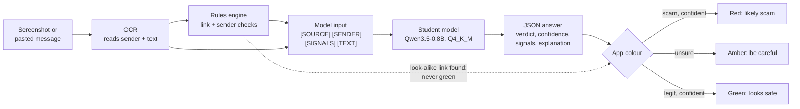
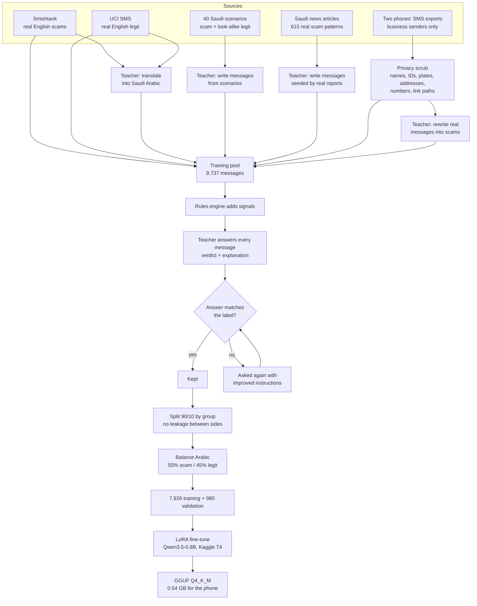
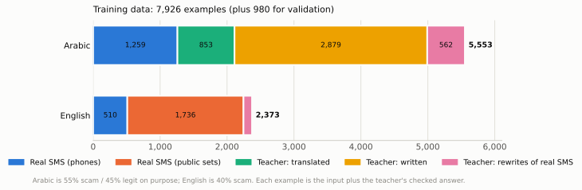
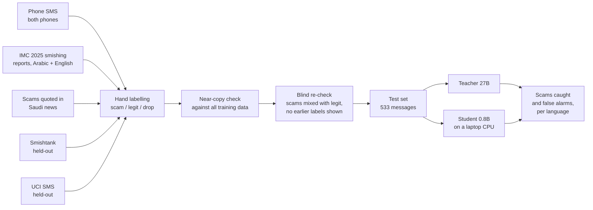
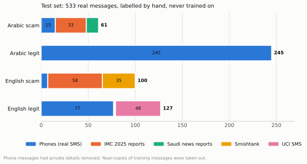
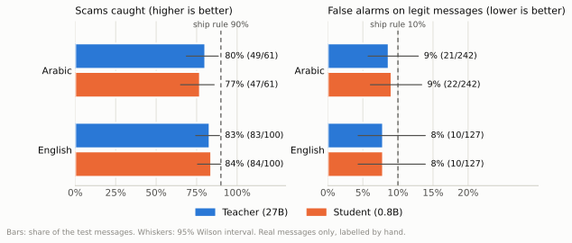
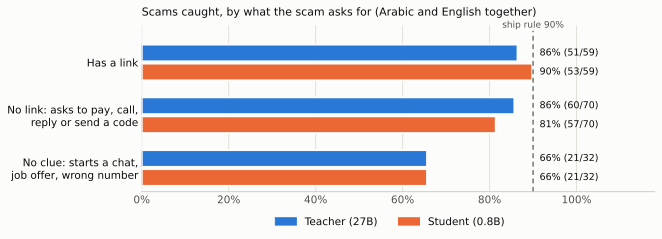

# Hather (حذِر): on-device scam detection for SMS and WhatsApp

Hather checks a text message for scams **on the phone**, in **Arabic and English**, and explains its
answer in the message's language. It is built for people in Saudi Arabia: Saudi banks, government
services, delivery companies and telecoms, and the scams that copy them.

Two parts work together:

- a **rules engine** (plain code, no AI) that checks what can be proven: look-alike links, links that
  do not belong to the brand a message names, link shorteners, bare IP links, and the sender format;
- a **small language model** (Qwen3.5-0.8B, about 0.5 GB) that reads the message and the rules
  engine's findings, decides *scam* or *legit*, and writes a short explanation.

The small model was **distilled** from a 27B teacher model: the teacher labelled and explained about
9,700 messages, and the student learned to answer the same way. Nothing leaves the phone.

> Status: research prototype. The student is as good as its 27B teacher on a hand-labelled test set
> of 533 real messages, but neither reaches the target of catching 90% of scams yet (see Results).

---

## How it works on the phone



Every message reaches the model in one fixed format, the same in training and in the app:

```
[SOURCE] sms
[SENDER] AlRajhiBank
[SIGNALS] brand_link_mismatch
[TEXT] ...the message...
```

The signals are **hints the model weighs, not verdicts**: a real company message can trip a rule,
and a scam can trip none.

| Signal | Fires when |
| --- | --- |
| `lookalike_domain` | a link imitates a known brand's domain (misspelling, extra words, Punycode) |
| `brand_link_mismatch` | the message names a brand but links somewhere that brand does not own |
| `link_shortener` | a link hides its destination (bit.ly and about 30 others) |
| `link_ip` | a link is a bare IP address |
| `foreign_number_local_brand` | a Saudi brand is named but the sender is a non-Saudi number |
| `unknown_sender` | the sender is a phone number, not a contact or a business sender ID |

The engine knows 91 brands (Arabic and English names, official domains, sender IDs, former names
such as STC Pay → STC Bank) and is covered by 50 hand-written fixture messages and 83 tests.

---

## How the training data was built

There is very little public Arabic scam data, so most Arabic training messages were written by the
teacher model, grounded in real Saudi scam reports, and mixed with real SMS whose private details
were removed.



<picture>
  <source media="(prefers-color-scheme: dark)" srcset="docs/figures/training_data-dark.svg">
  
</picture>

**Design choices that mattered**

- **Grounded generation.** 686 teacher jobs were each seeded by a real scam pattern from Saudi news,
  or by a real organisation scammers impersonate (so legit look-alikes appear too).
- **Real company style on both sides.** Real legit SMS from two phones were added, and the teacher
  rewrote 800 of them into scams with the same wording and brand plus one trick (fake link, fee,
  threat, code request, prize). Otherwise "sounds like a real company" would mean "safe".
- **Shortcut checks.** A signal-rate table per source exposed two shortcuts before training
  (English legit messages had no senders; teacher-written legit messages had invented domains).
  Both were fixed.
- **Teacher instructions, version 2.** The first pass called about 1 in 8 real company messages a
  scam for weak reasons ("an OTP with no context"). The instructions were extended with what normal
  Saudi messages look like; a control set of 200 already-correct messages confirmed the teacher did
  not become more trusting (99% of scams still caught). Usable answers rose from 90.5% to 96.3%.
- **Group-aware split.** A message and its translation, all messages from one scenario or news seed,
  and all messages from one phone sender (with their rewrites) always land on the same side.
- **Language check.** An English message must get an English explanation and an Arabic one an Arabic
  explanation; bilingual company SMS may use either.

---

## How it was tested

The test set contains **only real messages, exactly as received, labelled by hand**, and none of them
was used for training.



<picture>
  <source media="(prefers-color-scheme: dark)" srcset="docs/figures/test_set-dark.svg">
  
</picture>

- **Ship rule:** catch at least 90% of scams with at most 10% false alarms, in both languages.
- Scam recall is measured only on scams, false alarms only on legit messages, so the mix does not
  bias either number; each group is large enough for a useful 95% interval.
- 17 candidates that were near-copies of training messages were removed. 16 real scams found
  hiding among the "legit" training messages were moved into the test set.
- The test set is kept private: real messages can contain links with personal tokens.

---

## Results

Scored on the same 530 test messages for both models (3 test scams are left out of the student's
score because rewrites of them were in its training data).

<picture>
  <source media="(prefers-color-scheme: dark)" srcset="docs/figures/results-dark.svg">
  
</picture>

| | Teacher (27B) | Student (0.8B) | Ship rule |
| --- | --- | --- | --- |
| Arabic scams caught | 49/61 = **80%** (69-88%) | 47/61 = **77%** (65-86%) | 90%+ |
| Arabic false alarms | 21/242 = 9% (6-13%) | 22/242 = 9% (6-13%) | 10% or less |
| English scams caught | 83/100 = **83%** (74-89%) | 84/100 = **84%** (76-90%) | 90%+ |
| English false alarms | 10/127 = 8% (4-14%) | 10/127 = 8% (4-14%) | 10% or less |

Ranges are 95% Wilson intervals.

**What the results show**

- **Distillation works.** A model about 30 times smaller matches its teacher on real messages, in
  both languages, runs on a laptop CPU at about 6 seconds per message, always returned valid JSON, and answered
  in the right language 98% of the time.
- **False alarms meet the target; scam recall does not.** Both models catch about 4 in 5 scams.
- **The limit is the training data, not the student's size.** Training kept only answers that matched
  the label, so every scam the teacher did not recognise was filtered out; the student never saw
  scams beyond what the teacher already understood.
- **Scams that ask for nothing yet are the hardest:**

<picture>
  <source media="(prefers-color-scheme: dark)" srcset="docs/figures/scam_kinds-dark.svg">
  
</picture>

- **Confidence is not informative yet.** The student answers with confidence 95 almost every time,
  so the app's amber colour never appears from the written number alone.

## Next steps

1. Keep hard examples in training: when the teacher disagrees with a known-correct label, give it the
   label and ask only for the explanation.
2. Add the scam kinds it misses (chat starters, no-link requests to call, reply or pay, company-style
   scams with ordinary links) and real company messages that do trip a signal.
3. Remove real scams hidden among the "legit" phone messages; add the missing official domains to
   the rules engine.
4. Derive the app's confidence from the model's token probabilities instead of the written number.
5. Retrain once and re-test on the same frozen test set.

---

## Privacy

- Phone exports never leave the laptop; only business-sender messages are kept, never saved contacts
  or personal chats.
- Before any real message enters training: phone numbers, IBANs, card and account numbers, names
  (after greetings and in transfer fields, plus a private list of known names), national IDs, car
  plates, addresses and e-mail addresses are hidden; every number of 3+ digits gets new random digits;
  link paths and booking codes are scrambled while the domain is kept.
- Training runs used private Kaggle datasets. The raw data, the training data, the test set and the
  trained model are **not** part of this repository.

---

## Repository layout

```
rules/        rules engine (engine.py), brands.json, fixtures + tests, README = exact spec for the app port
data/         pipeline scripts: pool building, scraping, phone SMS, privacy scrub, teacher jobs,
              Run B split / redo / merge, balancing, test-set building, evaluation
notebooks/    Kaggle notebooks: teacher runs (llama.cpp on 2x T4) and student training (Unsloth)
eval/         review.html, an offline labelling page
docs/figures/ the figures above
```

**Pipeline, in order**

```
python data/build_pool.py                                   # English public SMS pool
python data/make_runA_jobs.py                               # translate + generate jobs -> teacher_runA.ipynb
python data/scrape_news.py collect / extract                # Saudi news scam reports
python data/make_grounded_jobs.py                           # report-seeded jobs -> teacher_runA.ipynb
python data/fix_pool.py ... && python rules/apply_rules.py  # shortcut fixes + signals
python data/phone_sms.py data/raw/phones/sms-<name>.xml     # phone export -> candidates (counts only)
python data/real_train.py                                   # privacy scrub + keep away from the test set
python data/make_rewrite_jobs.py                            # real SMS -> scam rewrites (teacher_prep.ipynb)
python data/build_mix.py --rewrites <rewrites.jsonl>        # final training pool
python data/make_runB_jobs.py <pool> -o <jobs>              # teacher answers -> teacher_runB.ipynb
python data/make_redo_jobs.py && python data/merge_runB.py  # re-ask failures with prompt v2 + control check
python data/split_runB.py <labels> <pool>                   # keep correct answers, group split
python data/balance_train.py                                # Arabic 55/45
# notebooks/student_train.ipynb on Kaggle -> GGUF
python data/eval_student.py serve|answer|report             # score on the private test set
```

Requirements for the scripts: `pip install -r rules/requirements.txt` (`tldextract==5.4.0` is pinned
on purpose: its bundled public-suffix list decides how domains split).

---

## Data and model credits

- **Smishtank** smishing dataset ([smishtank.com](https://smishtank.com/dataset)), CC BY-NC-SA 4.0:
  this project therefore stays free and non-commercial.
- **UCI SMS Spam Collection** (legit messages only).
- **IMC 2025 smishing dataset**, UCL ([GitHub](https://github.com/reportsmishing/Smishing-Dataset-IMC25)), CC BY 4.0.
- Saudi news reports on SMS fraud (patterns only; full articles are not redistributed).
- Models: **Qwen3.8-27B** (teacher, run with llama.cpp) and **Qwen3.5-0.8B** (student, fine-tuned
  with Unsloth); see each model card for its licence.
